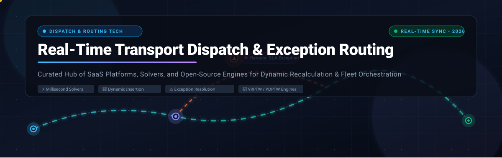
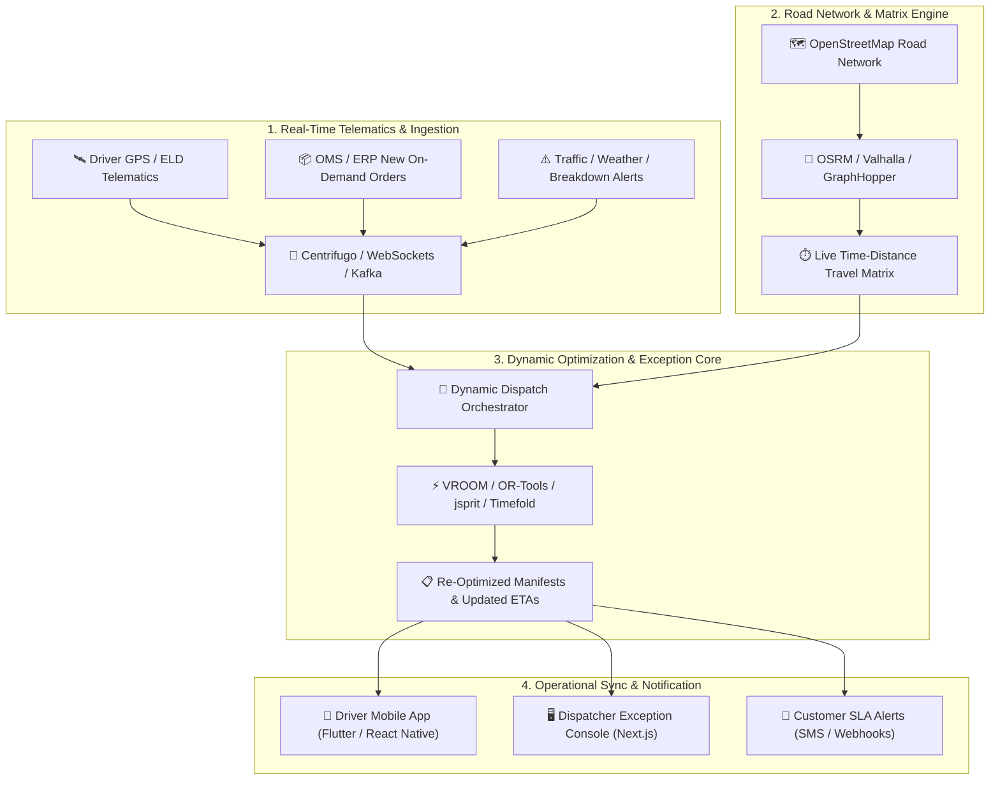

<div align="center">



# 🚚 Real-Time Transport Dispatch &amp; Exception Routing Ecosystem

### A Curated Directory of Enterprise SaaS Platforms, Open-Source VRP Solvers &amp; Dynamic Dispatch Engines

<p align="center">
  <em>Master dynamic route recalculation, automated exception management, on-demand dispatch, and real-time fleet orchestration.</em>
</p>

<!-- Badges Section -->
<p align="center">
  <a href="https://github.com/ishandutta2007/Awesome-Awesome-Awesome"></a><a href="https://discord.gg/jc4xtF58Ve"></a>
  <a href="https://github.com/ishandutta2007/Awesome-Real-Time-Transport-Dispatch-Exception-Routing/stargazers"></a>
  <a href="https://github.com/ishandutta2007/Awesome-Real-Time-Transport-Dispatch-Exception-Routing/network/members"></a>
  <a href="https://github.com/ishandutta2007/Awesome-Real-Time-Transport-Dispatch-Exception-Routing/issues"></a>
  <a href="https://github.com/ishandutta2007/Awesome-Real-Time-Transport-Dispatch-Exception-Routing/pulls"></a>
  <a href="https://github.com/ishandutta2007/Awesome-Real-Time-Transport-Dispatch-Exception-Routing/blob/main/LICENSE"></a>
  <a href="https://github.com/ishandutta2007"></a>
</p>

</div>

---

## 📖 Executive Summary &amp; SEO Overview

In modern logistics, last-mile delivery, and freight transportation, static morning routes rarely survive contact with reality. Traffic congestion, unexpected delivery delays, vehicle breakdowns, emergency order cancellations, and priority on-demand pickups demand **Real-Time Transport Dispatch &amp; Exception Routing**.

This repository curates market-leading **commercial SaaS platforms** and powerful **open-source Vehicle Routing Problem (VRP) engines**. These tools enable fleet operators and logistics engineers to:
- ⚡ **Recalculate routes on the fly** within sub-second latencies when unplanned events occur.
- ⚠️ **Detect and route exceptions automatically**, such as predicted SLA time window violations, capacity overflows, and missing proof-of-deliveries.
- 🔄 **Perform dynamic order insertion** into active vehicle manifests without dropping committed customer time commitments.
- 📱 **Synchronize drivers, dispatchers, and customers** via low-latency telematics, mobile SDKs, and accurate predictive ETAs.

---

## 📑 Table of Contents
- [📊 Sector Overview &amp; Market Dynamics](#-sector-overview--market-dynamics)
- [🏢 SaaS &amp; Commercial Hosted Platforms](#-saas--commercial-hosted-platforms)
- [🔓 Open-Source GitHub Projects &amp; Engines](#-open-source-github-projects--engines)
- [🛠️ Algorithmic Libraries &amp; Specialized Toolkits](#️-algorithmic-libraries--specialized-toolkits)
- [🧩 High-Performance Architecture Blueprint](#-high-performance-architecture-blueprint)
- [🤝 How to Contribute](#-how-to-contribute)
- [⭐ Star History](#-star-history)
- [💖 Support &amp; Sponsorship](#-support--sponsorship)
- [⚖️ Disclaimer](#-disclaimer)

---

## 📊 Sector Overview &amp; Market Dynamics

The global **Route Optimization &amp; Dynamic Dispatch Software Market** is estimated at **$9.6 billion to $12.9 billion in 2026** and is projected to expand to **$21.5 billion by 2030** at a Compound Annual Growth Rate (CAGR) of **14% to 18%**, situated within the broader **$27 billion to $32+ billion Commercial Fleet Telematics &amp; Management** industry.

### 🌐 Market Structure: Moderately Fragmented
The sector exhibits a **moderately fragmented** competitive landscape rather than a winner-take-all monopoly:
- **Enterprise Telematics &amp; Compliance Behemoths** (e.g., Samsara, Motive, Trimble) dominate broad cross-fleet hardware gateways, ELD compliance, and video safety.
- **Specialized Real-Time Dispatch &amp; Last-Mile Orchestrators** (e.g., Bringg, Onfleet, Circuit, OptimoRoute, Routific) capture high-growth delivery, retail fulfillment, and localized fleet niches through agile API-first routing engines.
- **Self-Hosted Open-Source Innovators** (e.g., VROOM, OSRM, OR-Tools, GraphHopper) provide logistics engineering teams with the foundational sovereignty required to avoid per-vehicle licensing fees and develop bespoke algorithmic constraint pipelines.

---

## 🏢 SaaS &amp; Commercial Hosted Platforms

The table below outlines leading commercial real-time transport dispatch and dynamic exception routing platforms, **sorted in descending order by company scale (valuation / annual revenue)**.

| 🏢 Platform | 💰 Company Scale (Valuation / Revenue) | 🏷️ Starting Tier Price | 🎁 Free Tier / Free Trial Limits | 🚀 Key Capabilities &amp; Exception Focus |
|:---|:---|:---|:---|:---|
| **[Samsara](https://www.samsara.com/)** | **$24.3B Market Cap** (NYSE: IOT)<br>• ~$2.1B ARR / $1.85B Rev | **$27–$33/vehicle/month**<br>*(Base telematics; $99–$148 upfront gateway; 3-yr term. Scales to $40–$60+/mo with AI dashcam)* | **No free forever tier**<br>• **30-day free hardware trial** (Includes vehicle gateway, sensors &amp; full cloud operations platform with prepaid return label) | Connected operations platform with real-time GPS fleet tracking, automated geofence deviation detection, AI video safety, and instant route delay exception alerts. |
| **[Trimble Transportation](https://transportation.trimble.com/)** | **~$18.0B Parent Market Cap** (NASDAQ: TRMB)<br>• ~$550M Transportation ARR | **$30–$35/vehicle/month**<br>*(Entry PC\*Miler routing modules; TruckMate from ~$1,000/yr; enterprise TMS contracts avg ~$62,250/yr)* | **No free forever tier**<br>• **21 to 30-day free trial** on standalone routing tools (e.g., PC\*Miler Web with single-user fleet testing; enterprise TMS via guided sales pilot) | Heavy commercial enterprise transportation management system (TMS), dynamic truck-specific routing, hazardous materials compliance, and multi-carrier exception dispatching. |
| **[Motive](https://gomotive.com/)** | **$2.85B Valuation** (Series F)<br>• $600M ARR ($1.3B Growth Fin.) | **$25–$35/vehicle/month**<br>*(Base compliance/ELD; Full dynamic dispatch, tracking, and safety tiers start at $40–$50/vehicle/mo)* | **No free forever tier**<br>• **14 to 30-day pilot program** (Tailored hardware/software evaluation program provided upon sales qualification) | Automated dispatch orchestration, AI dash cams, Hours of Service (HOS) exception detection, driver coaching, and live vehicle diagnostics. |
| **[Bringg](https://bringg.com/)** | **$1.0B Valuation** (Series E Unicorn)<br>• ~$45M ARR ($184M+ Funded) | **$10,000–$20,000/year**<br>*(Approx. $833–$1,667/month entry baseline for fleet &amp; delivery hub modules; enterprise tiers up to $1M+/yr)* | **No free forever tier**<br>• **Custom 14 to 30-day guided POC** (Structured proof-of-concept pilot with prospective customer delivery data; no self-serve sign-up) | Enterprise-grade delivery orchestration, multi-carrier parcel injection, dynamic rerouting, click-and-collect logistics, and automated customer SLA exception workflows. |
| **[DispatchTrack](https://dispatchtrack.com/)** | **~$350M Est. Valuation**<br>• ~$40M ARR ($144M Funded) | **$75/driver/month**<br>*(Reference list tier; typical commercial deployments require ~$500/month minimum fleet spend)* | **No free forever tier**<br>• **14 to 30-day custom POC pilot** (Simulated dispatch environments using historical customer delivery records upon sales review) | AI-powered last-mile logistics, hard/soft time-window enforcement, real-time customer tracking, exception handling for damaged goods, and proof-of-delivery (POD). |
| **[Circuit (Spoke Dispatch)](https://getcircuit.com/)** | **~$200M Est. Valuation**<br>• ~$40M ARR (Bootstrapped) | **$125/month** Starter Tier<br>*(Circuit for Teams covers up to 1,000 stops/mo with unlimited drivers &amp; dispatchers; $0.12/extra stop)* | **Free forever tier on mobile**<br>• Free for individual drivers up to **10 stops/route**<br>• Teams includes a **14-day free trial** (Up to 500 stops, live GPS &amp; dispatch dashboard) | Fast route optimization for delivery fleets, instant stop re-sequencing on driver app, live driver tracking, barcode package scanning, and recipient notifications. |
| **[Wise Systems](https://wisesystems.com/)** | **$200M Valuation** (Series C)<br>• ~$15M ARR ($73M Funded) | **$50/driver/month**<br>*(Enterprise marketplace entry rate; full autonomous dynamic dispatch contracts avg ~$12,000–$15,000/year base)* | **No free forever tier**<br>• **14 to 30-day tailored POC** (Model validation and algorithmic route testing conducted with prospective fleet operations data) | Autonomous dispatching and routing platform utilizing continuous machine learning to re-optimize routes dynamically as live traffic and delivery conditions shift. |
| **[Onfleet](https://onfleet.com/)** | **~$175M Est. Valuation**<br>• ~$20M ARR ($41.7M Funded) | **$619/month** Launch Tier<br>*(Includes 2,500 delivery tasks/month, unlimited drivers/dispatchers, full API access; $0.26/extra task)* | **No free forever tier**<br>• **14-day free trial** (Full platform dashboard access, iOS/Android driver mobile apps, and up to 2,500 test tasks, no credit card required) | Full-lifecycle delivery management, automated dispatch assignment, dynamic arrival ETAs, chat with drivers, and real-time failed delivery exception management. |
| **[OptimoRoute](https://optimoroute.com/)** | **~$40M Est. Valuation**<br>• ~$8M ARR ($10.7M Funded) | **$35.10/driver/month**<br>*(Lite annual billing or $39/mo monthly; Pro tier is $44.10/driver/mo; covers up to 700 orders/driver/mo)* | **No free forever tier**<br>• **30-day free trial** (Full Pro plan access including live tracking, multi-day routes, and analytics; no credit card required) | High-density route planning, live order insertion, multi-day long-haul routing, driver schedule constraints, and automated exception alerts for overdue deliveries. |
| **[Routific](https://routific.com/)** | **~$25M Est. Valuation**<br>• ~$6M ARR ($2.5M Funded) | **$150/month**<br>*(Flat pricing for 101 to 1,000 orders/month with unlimited drivers and vehicles; scales down to $0.08–$0.15/order above 1,000)* | **Free forever tier**<br>• **100 orders/month permanently free** with full core routing &amp; unlimited drivers<br>• **7-day free trial** up to 5,000 stops (No credit card required) | Clean, intuitive last-mile delivery route optimization, driver mobile app, automated SMS/email customer notifications, and drag-and-drop live dispatch rescheduling. |

---

## 🔓 Open-Source GitHub Projects &amp; Engines

This section indexes premier open-source route optimization engines, routing machines, constraint solvers, and dispatch platforms. 

All repositories are **strictly sorted in descending order by GitHub stargazers count**, with official white social badges linking directly to each project's stargazers page.

| # | 📦 Repository &amp; Stargazers Link | 🏷️ Stargazers Badge | 💻 Tech Stack | 🎯 Core Engine Focus &amp; Exception Routing Capabilities |
|:---:|:---|:---:|:---|:---|
| 1 | **[Google OR-Tools](https://github.com/google/or-tools)** | [](https://github.com/google/or-tools/stargazers) | C++, Python, Java, C# | **The global benchmark for combinatorial optimization and VRP solving.** Fast, flexible exact and heuristic solvers supporting multi-depot CVRP, VRPTW, pickups and deliveries (PDP), capacity dimensions, custom penalty breakages, and disjunctions for dropping unfeasible orders. |
| 2 | **[OSRM (Open Source Routing Machine)](https://github.com/Project-OSRM/osrm-backend)** | [](https://github.com/Project-OSRM/osrm-backend/stargazers) | C++20 | **High-performance routing engine designed to run on OpenStreetMap data.** Calculates shortest paths in milliseconds via Contraction Hierarchies (CH) and Multi-Level Dijkstra (MLD). Serves as the travel-time matrix engine backbone for VROOM, better-route, and dispatch engines. |
| 3 | **[GraphHopper Routing Engine](https://github.com/graphhopper/graphhopper)** | [](https://github.com/graphhopper/graphhopper/stargazers) | Java | **Fast and memory-efficient OpenStreetMap road routing engine.** Supports custom vehicle profiles, speed profiles, elevation, turn costs, and matrix calculations. Houses the integrated **jsprit** toolkit for solving complex vehicle routing problems. |
| 4 | **[Valhalla](https://github.com/valhalla/valhalla)** | [](https://github.com/valhalla/valhalla/stargazers) | C++ | **Open-source routing engine and microservices architecture.** Offers dynamic tile hierarchies, multimodal routing (car, truck, transit, pedestrian), time-dependent matrix computation, elevation-aware routing, and map matching for tracking live GPS traces. |
| 5 | **[Openrouteservice](https://github.com/GIScience/openrouteservice)** | [](https://github.com/GIScience/openrouteservice/stargazers) | Java | **Geospatial routing API built upon OpenStreetMap data by Heidelberg University.** Provides routing, isochrones, time-distance matrices, and out-of-the-box VRP optimization via its integrated optimization endpoint powered by VROOM. |
| 6 | **[VROOM](https://github.com/VROOM-Project/vroom)** | [](https://github.com/VROOM-Project/vroom/stargazers) | C++20 | **The leading standalone vehicle routing optimization solver.** Solves TSP, CVRP, VRPTW, heterogeneous fleets, and paired pickup-and-delivery (PDPTW) within milliseconds. Natively interfaces with OSRM, Valhalla, and Openrouteservice matrices. |
| 7 | **[jsprit](https://github.com/graphhopper/jsprit)** | [](https://github.com/graphhopper/jsprit/stargazers) | Java | **Lightweight, modular, open-source Java library for solving rich VRPs.** Leverages meta-heuristics (Large Neighborhood Search / ruin-and-recreate) to handle pickup and delivery with time windows, multiple depots, heterogeneous fleets, and driver skills. |
| 8 | **[Timefold Solver](https://github.com/TimefoldAI/timefold-solver)** | [](https://github.com/TimefoldAI/timefold-solver/stargazers) | Java, Python | **Enterprise AI constraint solver** (continuation of OptaPlanner). Solves continuous dynamic vehicle routing, driver shift scheduling, real-time order insertion, and hard/soft constraint violation scoring with warm-start solving. |
| 9 | **[pgRouting](https://github.com/pgRouting/pgrouting)** | [](https://github.com/pgRouting/pgrouting/stargazers) | C, C++, PL/pgSQL | **Geospatial routing extension for PostGIS and PostgreSQL.** Adds shortest path search (Dijkstra, A\*, bidirectional search), Traveling Salesperson Problem (TSP) algorithms, and multi-modal network analysis directly inside relational databases. |
| 10 | **[PyVRP](https://github.com/PyVRP/PyVRP)** | [](https://github.com/PyVRP/PyVRP/stargazers) | Python, C++ | **State-of-the-art Vehicle Routing Problem package in Python.** Implements hybrid genetic search algorithms with ultra-fast C++ performance-critical kernels for VRPTW, multi-depot VRP, and custom fleet constraints. |
| 11 | **[reinterpretcat / VRP Solver](https://github.com/reinterpretcat/vrp)** | [](https://github.com/reinterpretcat/vrp/stargazers) | Rust | **High-performance Vehicle Routing Problem solver written in Rust.** Employs pragmatic heuristic algorithms to solve multi-vehicle routing problems with complex constraints, capacity dimensions, breaks, and time windows. |
| 12 | **[VROOM Docker](https://github.com/VROOM-Project/vroom-docker)** | [](https://github.com/VROOM-Project/vroom-docker/stargazers) | Dockerfile, Shell | **Turnkey containerized deployment stack for VROOM.** Bundles the C++ VROOM binary with the `vroom-express` HTTP API wrapper, enabling instant microservice routing deployments alongside OSRM or Openrouteservice containers. |
| 13 | **[mpee](https://github.com/punnerud/mpee)** | [](https://github.com/punnerud/mpee/stargazers) | Rust, Python | **Offline routing, multi-vehicle VRP solver, and geocoder** for pre-downloaded map areas. Built with a Rust engine (`brooom`/`dijeng`), CLI, and HTTP server (`brooom --serve 8088`). Ideal for rural fleets or embedded vehicular hardware lacking cellular data. |
| 14 | **[RouteOpt](https://github.com/INFORMSJoC/2025.1415)** | [](https://github.com/INFORMSJoC/2025.1415/stargazers) | C++ | **Exact modular solver for CVRP and VRPTW** published in INFORMS Journal on Computing. Features novel node restoration branch-and-bound mechanisms with custom branching and cutting planes. Interfaces with CPLEX and Gurobi. |
| 15 | **[better-route](https://github.com/EijunnN/better-route)** | [](https://github.com/EijunnN/better-route/stargazers) | TypeScript, Next.js, Flutter | **Complete self-hosted route optimization and dispatch management platform.** Powered by VROOM + OSRM. Includes Next.js 16 web dashboard, PostgreSQL + Drizzle ORM, Centrifugo WebSockets for real-time live driver updates, and a cross-platform Flutter mobile driver app. |
| 16 | **[Lynxo](https://github.com/TRADLY-PLATFORM/Lynxo)** | [](https://github.com/TRADLY-PLATFORM/Lynxo/stargazers) | TypeScript, React 19, Tailwind | **Production starter kit for last-mile on-demand delivery.** Features live product catalogs, automated order creation, mock testing mode, and continuous real-time delivery status polling every 10 seconds. |
| 17 | **[Oway Dispatch Console](https://github.com/faalbane/oway-dispatch-console)** | [](https://github.com/faalbane/oway-dispatch-console/stargazers) | JavaScript | **Carrier dispatch console for LTL shipments.** Manages status-aware route generation (ASSIGNED, PICKED_UP, DELIVERED), flags SLA time window violations without dropping routes, and handles atomic cross-vehicle shipment reassignment. |
| 18 | **[Smart Logistics VRP](https://github.com/rodrigope12/smart-logistics-vrp)** | [](https://github.com/rodrigope12/smart-logistics-vrp/stargazers) | Python, FastAPI, React Native | **Full-stack logistics stack using Google OR-Tools.** Features mandatory security checkpoint routing for hazardous/high-risk zones, offline-first React Native mobile app for proof-of-delivery sync, and automated PDF invoicing. |

---

## 🛠️ Algorithmic Libraries &amp; Specialized Toolkits

In addition to core GitHub platforms, specialized packages and architectures solve distinct dispatch sub-problems:

- **[pdptw-lns-solver (PyPI)](https://pypi.org/project/pdptw-lns-solver/0.1.1/)** — Fast Large Neighborhood Search (LNS) solver for online transit and delivery dispatch. Inserts dynamic orders into existing schedules without dropping previously committed appointments. Works directly with OSRM matrices.
- **[Nextroute (PyPI)](https://pypi.org/project/nextroute/1.8.0.dev2/)** — High-performance VRP engine written in pure Go with Python bindings. Supports alternate stops, cluster constraints, maximum travel duration, early/late arrival penalties, and vehicle activation costs.
- **[Vantal Tech Exception Kit](https://github.com/ishandutta2007/Awesome-Awesome-Awesome)** — Lightweight local-first event handler for retail and logistics exception handling: ingests telematics events, applies rule-based SLA tripwires, and notifies ops teams in Slack.
- **[Agentic Logistics — Shipment Exception Pattern](https://github.com/ishandutta2007/Awesome-Awesome-Awesome)** — SQL and LLM-driven shipment exception agent that correlates live GPS delay events with customer contract SLAs, recalls similar historical resolutions, and drafts customer notifications and carrier reroutes.

---

## 🧩 High-Performance Architecture Blueprint

A production-grade, self-hosted dynamic transport dispatch and exception routing architecture typically combines the following decoupled layers:



---

## 🤝 How to Contribute

Contributions, bug fixes, and new project additions are warmly welcomed! 

1. 🍴 **Fork the repository** to your own GitHub profile.
2. 🌿 **Create a feature branch**:
   ```bash
   git checkout -b feature/add-new-routing-engine
   ```
3. 📝 **Add your entry** to `README.md` maintaining table formatting, pricing transparency, and accurate stargazer links.
4. 🚀 **Commit your changes**:
   ```bash
   git commit -m "Add NewEngine to open-source VRP table"
   ```
5. 📬 **Open a Pull Request** with a brief summary of the project and why it belongs in the dispatch ecosystem.

---

## ⭐ Star History

[](https://star-history.dera.page/#ishandutta2007/Awesome-Real-Time-Transport-Dispatch-Exception-Routing&type=date&legend=top-left)

---

## 💖 Support &amp; Sponsorship

Thank you so much for exploring and using this curated real-time transport dispatch and exception routing guide! If you find this repository valuable for your logistics engineering work, fleet operations, or research:

- ⭐ **Star this repository** on GitHub to help others discover it!
- 🍴 **Fork and share** it with your teammates, engineering peers, and logistics communities.
- ☕ **Support continuous maintenance**: Buy us a coffee or sponsor ongoing curation via the GitHub Sponsor Dashboard:  
  👉 **[Sponsor @ishandutta2007 on GitHub](https://github.com/sponsors/ishandutta2007)**

---

## ⚖️ Disclaimer

- This repository is a **community-curated index** provided for educational and architectural reference. Product names, logos, and trademarks belong to their respective corporate owners.
- Route optimization outputs and automated dispatch recommendations must be validated against real-world transportation regulations (DOT, FMCSA, Hours of Service, vehicle gross weight limits, and hazardous material restrictions) before live dispatch.
- Self-hosted open-source stacks require appropriate OpenStreetMap data pipeline maintenance, routing profile tuning, and rigorous road test validation.

---

<div align="center">
  <sub>Maintained with ❤️ by <a href="https://github.com/ishandutta2007">Ishan Dutta</a> and the global open-source logistics community.</sub>
</div>
